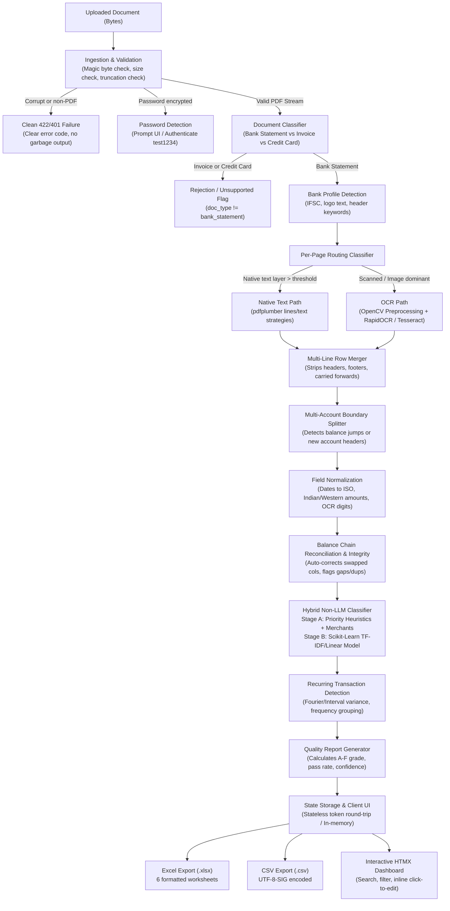

# Architecture & Pipeline Design

The **Bank Statement Processing & Classification System** is engineered as a deterministic, non-LLM document intelligence engine designed to run both locally and inside serverless environments (specifically Vercel Fluid Compute).

---

## 1. End-to-End Processing Architecture

The following Mermaid sequence diagram illustrates the lifecycle of a document from file upload to final structured export:

---

## 2. Key Pipeline Stages

### Stage 1: Ingestion & Document Verification
- **Magic Bytes Validation**: Inspects initial byte signatures (`%PDF-`) rather than trusting file extensions. Detects renamed binaries, PNGs, and corrupted streams upfront.
- **Encryption Handshake**: PyMuPDF intercepts encrypted PDFs without throwing unhandled exceptions, prompting the user for credentials and accepting passwords like `test1234`.
- **Document Classification**: Evaluates multi-token signal weights distinguishing bank statements (opening/closing balance, IFSC, running balance) from credit card statements (credit limit, payment due date) and invoices (tax invoice, vendor, bill to).

### Stage 2: Per-Page Dynamic Routing
- PDF pages often mix text-layer and scanned pages within a single file (e.g. sample file `12_mixed_text_pages_and_scanned_pages.pdf`).
- Evaluates character counts and image bounding box coverage per page.
- Directs clean text pages to `pdfplumber` vector extraction and scanned pages to the OCR preprocessing pipeline.

### Stage 3: Image Preprocessing & OCR Recovery
- Pages rendered at 250 DPI.
- **Orientation & Deskew**: Scores horizontal projection profile variance across 0°, 90°, 180°, and 270° without depending on Tesseract OSD (enabling full compatibility with Vercel serverless where Tesseract binaries cannot run).
- **Table Recovery**: Clusters OCR word bounding boxes along Y-coordinates into rows and detects stable column boundaries via gap histogramming.
- Pluggable OCR engines: **RapidOCR** (ONNX Runtime, bundled in repo) for Vercel/serverless, and **Tesseract** for local Docker execution.

### Stage 4: Row Merging & Normalization
- Continuation lines (where dates and amounts are absent) are folded back into the parent transaction's narration.
- Strips repeated table headers across pages, summary disclaimers, and carry-forward sentinels (`BROUGHT FORWARD`, `CARRIED FORWARD`, `BALANCE B/F`).
- Normalizes diverse Indian formats (`1,23,456.78`) and Western formats (`1,234,567.89`), bracketed negatives `(1,250.00)`, and date formats (`DD/MM/YYYY`, `DD MMM YYYY`, `MMM DD, YYYY`).

### Stage 5: Balance Integrity & Auto-Correction
- Performs sequential row verification: `Previous Balance - Debit + Credit == Balance`.
- **Auto-Correction**: When a row fails reconciliation, tests whether swapping Debit and Credit restores balance continuity. If it does, automatically corrects the columns and flags the row for audit.
- Flags planted anomalies: duplicate transactions, balance chain jumps, out-of-period dates, and zero-amount entries.

### Stage 6: Two-Stage Non-LLM Classification
- **Stage A (Rules Engine)**: Config-driven YAML rules matching payment channels (UPI, NEFT, IMPS, ATM, POS), transaction directions, and 100+ fuzzy-matched merchant aliases (`rapidfuzz`). Rule confidence $\ge 0.75$ assigns immediately.
- **Stage B (Machine Learning Model)**: Calibrated Linear Model trained on word n-grams (1-2) + char n-grams (3-4) TF-IDF features and direction one-hot encoding.
- **Numpy Serving Architecture**: The trained scikit-learn model weights and vocabulary are exported to `.npy`/`.npz` arrays. Runtime inference uses pure numpy vector arithmetic, eliminating heavy dependencies (`scikit-learn`, `scipy`, `pandas`) from the Vercel function bundle.

### Stage 7: Analytics & Stateless Presentation
- Detects recurring payment cadences (monthly, weekly, biweekly) using amount variance and interval distribution analysis.
- Generates 6-sheet formatted Excel workbooks (`Transactions`, `Account Summary`, `Category Summary`, `Monthly Summary`, `Recurring Payments`, `Quality Report`).
- UI operates via **HTMX partial swaps**, server-side search, filtering, and click-to-edit inline corrections that instantly re-run balance reconciliation.

